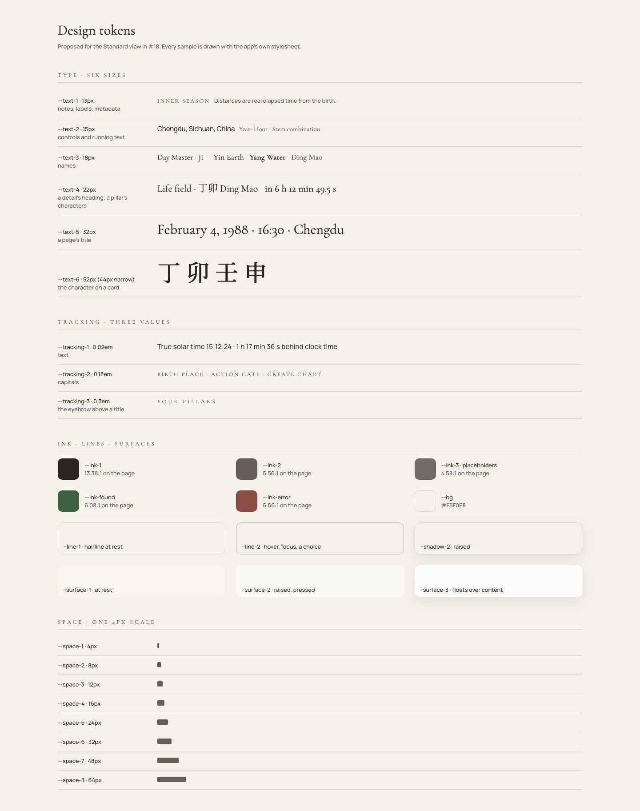

# Design Tokens (Standard view)

The Standard view's stylesheet, `eight_characters/static/style.css`, takes every
colour, space, font size, line height, tracking, corner radius and control height
from tokens defined once on `:root`. Outside those definitions it holds no raw
spacing, font size, line height, tracking, radius or ink value:
`tests/test_api_index_route.py` (`test_stylesheet_takes_its_values_from_its_tokens`)
fails on any.

## Colour

| Token | Value | Use |
|---|---|---|
| `--bg` | `#F5F0E8` | the page |
| `--ink-1` | `#2A2520` | text (13.4:1 on the page) |
| `--ink-2` | `#655F58` | labels, notes, secondary text (5.6:1) |
| `--ink-3` | ink at 65% | placeholders (4.6:1) |
| `--ink-found`, `--ink-error` | `#3F6246`, `#8B4E45` | a found place; an error (6.1:1, 5.7:1) |
| `--line-1`, `--line-2` | ink at 12%, 30% | a hairline at rest; hover, focus, a current choice |
| `--surface-1`, `--surface-2`, `--surface-3` | white at 30%, 50%; white at 80% on the page tone, opaque | at rest; raised or pressed; floating over content, which nothing beneath reads through |
| `--surface-page-1`, `--surface-page-2` | the page tone at 85%, 92% | an option under the pointer; the active option |
| `--shadow-1`, `--shadow-2`, `--shadow-sheet` | | a focused field; anything raised; the sheet over the foot of the page |
| `--sheen` | | the light across a card's face |
| `--pin` | the place fields' pin, drawn in `--ink-1` | the pin at the end of a place field |
| `--<element>-bg`, `--<element>-text`, `--<element>-tint` | the tint: its element at 20% on the page tone (22% for metal and water), mixed opaque with `color-mix()` | each element's cards, their ink, and its hidden-stem panels |

`--ink-1` and `--ink-2` meet WCAG AA (4.5:1) on the page and on every
element-tinted panel. De-emphasis comes from size, case and tracking, not from a
lighter ink.

The browser's own parts take the page's ink: a radio button's mark (`accent-color`)
and, where the system always shows scrollbars, their thumb in `--line-2`
(`scrollbar-color`). Lists and dialogs that scroll inside themselves, and a
comparison's frames, draw thin ones.

### The dark theme

On screen, when the system's setting is dark (`prefers-color-scheme: dark`), the
colour tokens take the embers palette. It was chosen from three drawn on the chart.
Space, type and every rule that uses the tokens stay as they are. The page declares
its scheme (`color-scheme`), so the browser's own controls, such as the date and time
pickers, follow it. Paper keeps the day's colours.

| Token | Dark value |
|---|---|
| `--bg` | `#1C1916` |
| `--ink-1`, `--ink-2` | `#EEE7DC` (14.3:1), `#B2A99C` (7.5:1) |
| `--ink-3` | the ink at 60% |
| `--ink-found`, `--ink-error` | `#93C29B`, `#E6A094` |
| `--line-1`, `--line-2` | the ink at 14%, 34% |
| `--surface-1`, `--surface-2`, `--surface-3` | white at 4%, 8%; `#2C2824` at 96% on the page, opaque |
| `--pin` | the pin drawn in the dark `--ink-1` |
| `--surface-page-1`, `--surface-page-2` | the page tone at 85%, 92% |
| `--shadow-*`, `--backdrop`, `--sheen` | black at 35–55%; white light at 8% |
| `--metal-bg` / `--metal-text` | `#5C5851` / `#F3EFE8` |
| `--fire-bg` / `--fire-text` | `#7C3E34` / `#F8E6E1` |
| `--wood-bg` / `--wood-text` | `#3D5C38` / `#E7F1E4` |
| `--earth-bg` / `--earth-text` | `#6B5E2E` / `#F5EED4` |
| `--water-bg` / `--water-text` | `#384E5F` / `#E4EEF5` |

The tints mix the deep element colours on the dark page, by the same formula as by
day. Each element's type meets AA on its card (5.5:1 or more), `--ink-2` does on every
tint (5.7:1 or more), and each element's ring is 3:1 or more on every surface. The
foundations suite measures this in every state of both themes.

## Space

`--space-1` to `--space-8`: 4, 8, 12, 16, 24, 32, 48 and 64px. Margins, padding
and gaps use only these, or `calc()` of them.

## Shape

| Token | Radius | Use |
|---|---|---|
| `--radius-1` | 2px | a mark; a ring drawn around a line of text |
| `--radius-2` | 4px | a key; a ring around a block; where a stem meets its branch |
| `--radius-3` | 8px | an option or a row in a list; a tooltip; a toast |
| `--radius-4` | 12px | a control or a surface: a field, a button, a chip, a notice, the panel; a tile |
| `--radius-5` | 16px | a card; a dialog |
| `--radius-6` | 24px | a group of controls; the lane around a pillar |
| `--radius-pill` | 999px | a pill, whatever its height |
| `--radius-round` | 50% | a dot |

- A control that is a pill (a button, a choice, a topic, a chip) takes
  `--radius-pill`, so it stays a pill at a phone's taller touch height. The group
  around a row of them takes `--radius-6`: a pill while it holds one row, a rounded
  box when its choices wrap.
- A stem card rounds its top corners with `--radius-5` and meets its branch with
  `--radius-2`; the branch mirrors it. A tile (a saved chart's, the life grid's)
  does the same with `--radius-4`.
- The lane behind the luck pillar and the life grid's Luck column takes
  `--radius-6`: the cards' `--radius-5` plus the lane's `--space-2` inset.
- The gua's lines keep `--line-r`, 1px; the relationship arcs are half-ellipses,
  drawn in percentages of their box.

## Type

| Token | Size | Use |
|---|---|---|
| `--text-1` | 13px | notes, labels, metadata: the smallest size for content |
| `--text-2` | 15px | controls and running text |
| `--text-3` | 18px | names |
| `--text-4` | 22px | a detail's heading; a pillar's characters |
| `--text-5` | 32px | a page's title |
| `--text-6` | 52px (44px up to 640px wide) | the character on a card |

Text that sets no size of its own is running text: the page's body takes `--text-2`,
never the browser's 16px. A control's outline icon is `--control-icon`, 18px.

Today's days recede by their scale. Their words keep their size against it: on a
day, `--held` is the inverse of its scale, and a word's size is its token times
`--held` (the weekday at least `--text-3`), so no word is drawn under `--text-1`.
The stylesheet's guard accepts these held sizes, and no other size off the scale.

### Leading

| Token | Line height | Use |
|---|---|---|
| `--leading-1` | 1.15 | characters and names set close: a chip, a tile, a card's words |
| `--leading-2` | 1.35 | a heading or a name; a line that seldom wraps |
| `--leading-3` | 1.5 | running text |
| `--leading-4` | 1.7 | a note in the smallest size that runs to several lines |

A character alone sits in a line of its own height (`line-height: 1`). A row whose
height the layout depends on keeps its own token: a hidden stem's line
(`--hidden-stem-row`), and the luck ribbon's direction over its chips. Text that sets
no line height keeps its font's own.

- Families: `--font-serif` (Cormorant Garamond), `--font-sans` (Manrope), and
  `--font-glyph` (the Noto Serif TC subset of the 22 stems and branches). The
  serif and sans stacks name the Noto face second, so the stems and branches look
  the same wherever they appear.
- Tracking: `--tracking-1` (0.02em) for text, `--tracking-2` (0.18em) for
  capitals, `--tracking-3` (0.3em) for the eyebrow above a title. They are in em,
  so they follow the size.
- Weight 300 is not used below display sizes.
- Italic is Cormorant's own italic face, declared beside its upright one. Manrope
  has no italic, so italic text takes the serif; the browser never slants a face.
- A number and its unit are one word: durations join them with a no-break space.

## Controls

| Token | Height | Use |
|---|---|---|
| `--control-1` | 28px | a chip set in a line: the library button beside the chart's name |
| `--control-2` | 36px | a button, a choice in a pill, a topic, a list's row |
| `--control-3` | 48px | a field, and the main action |
| `--control-touch` | 44px | on a phone, every control grows to it |

A group of choices (a pill of them, the gender, the partner in view) is a control's
height plus its `--space-1` padding and hairline: 46px, and 54px on a phone. The
start page's language switch is itself a control's height, its two choices within
it, so it stands level with the account's button beside it.

## The pillars and the panel

- One grid holds all four pillars: four columns, two up to 640px wide. Each
  pillar spans eight shared rows (label, name, mark, stem arcs, stem, branch,
  hidden stems, branch arcs) as a subgrid, with its header and its cards as
  nested subgrids. The rows line up across the pillars, and the cards of a row
  share one height, front and back. Opened hidden stems grow their own row, in
  the flow: nothing hangs over what follows. `tests/browser/design-system.test.mjs`
  checks this from 641px to 1440px, in both languages.
- The relationship arcs lie in their own rows, under the pillars. Each row keeps
  one height whatever the arcs in it, so the cards stand in the same place; up
  to 640px there are no arcs and the rows are empty.
  - `--arc-base`, `--arc-step`: the rise of the lowest arc, and of each level
    above it: 6 and 8px.
  - `--arc-band`: the height of each arcs' row, room for four levels: 40px.
  - `--arc-spread`: the distance between the feet of arcs that meet on one card:
    6px.
- `--card-min-height`: a card's least height (160px up to 640px wide).
- `--hidden-stem-row`: the line of a hidden stem in its panel.
- `--chart-width`: the chart column, 960px.
- `--panel-width`: the panel that explains a topic beside the chart, from 1200px
  wide: 420px.
- `--sheet-height`: narrower, the panel is a sheet over the foot of the page, at
  most half the screen tall. The chart keeps as much room below it to scroll
  clear of the sheet.
- A page in the panel reads from the left:
  - its title in `--text-4`;
  - a line in `--ink-2`;
  - its content;
  - one note at its foot in `--text-1`, at most 35em wide: about 60 to 75
    characters to the line.

  Its labels, a pillar's plain name or a group of roles, take the column
  header's capitals. The roles matrix is no wider than `--panel-width`, so on a
  wide sheet each mark stays near its role.
- What a line in the panel points at is ringed on the chart in `--ink-1`:
  - a card with a 2px outline at no offset, so the ring stays within half the 4px gap
    between a pillar's stem and branch;
  - a hidden stem's row with a 2px outline.

  The pointing line takes `--surface-2`, spread by `--space-1` without moving.
